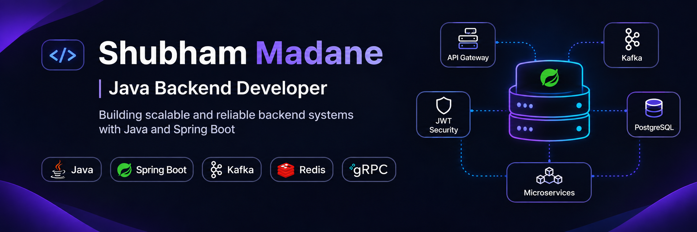

# Hey, I'm Shubham Madane 👋

### Java Backend Developer | Spring Boot | Microservices | Distributed Systems

I build backend applications using Java and Spring Boot, with a strong interest in distributed systems, event-driven architecture, and scalable backend engineering.

Currently focused on strengthening my backend engineering skills, system design fundamentals, and problem-solving abilities.

---

## 🛠️ Tech Stack

**Languages**

**Backend Development**

**Distributed Systems & Messaging**

**Databases & Tools**

---

## 🚀 Featured Projects

### 🏦 Distributed Banking System
**Java | Spring Boot | Kafka | Redis | MySQL | Microservices**

A distributed banking application demonstrating event-driven transaction processing, Saga-style workflows, and real-time fraud detection.

- Designed six Spring Boot microservices with separate responsibilities.
- Implemented Kafka-based transaction events and compensating refund workflows.
- Integrated Redis for fraud checks, OTP verification, and rate limiting.
- Used OpenFeign for inter-service communication.

[**View Source Code →**](https://github.com/Shubhamadane009/distributed-banking-system)

---

### 🏥 Patient Management System
**Java | Spring Boot | gRPC | Kafka | PostgreSQL | Spring Security**

A microservices-based backend application demonstrating secure API access and synchronous/asynchronous service communication.

- Implemented JWT authentication and API Gateway validation.
- Integrated gRPC for synchronous service communication.
- Implemented Kafka-based asynchronous patient event messaging.
- Used Spring Data JPA and PostgreSQL for persistence.

[**View Source Code →**](https://github.com/Shubhamadane009/patient-management)

## 💻 Problem Solving

- 130+ problems solved on LeetCode.
- Practicing Data Structures and Algorithms.
- Focused on Java problem-solving and core computer science fundamentals.

---

## 📊 GitHub Statistics

  

---

## 📫 Connect With Me

---

*Building, learning, and improving one commit at a time.*
